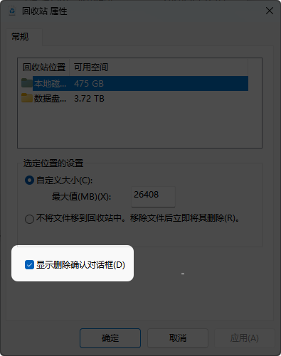
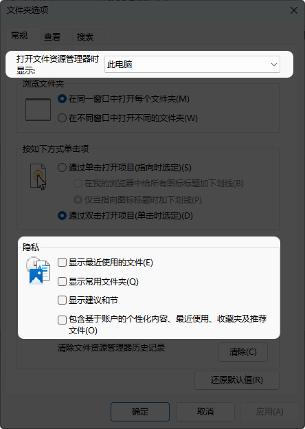
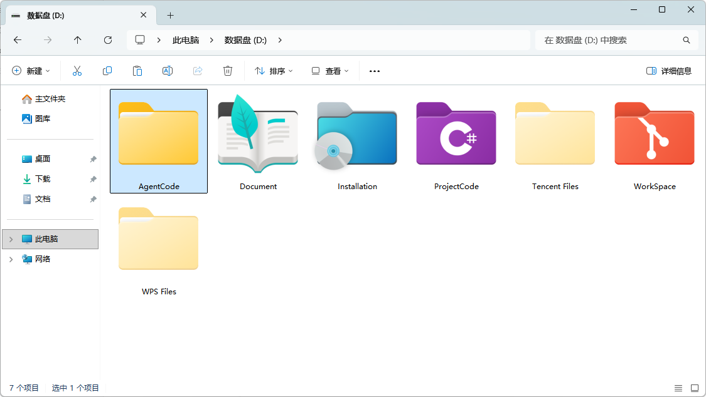
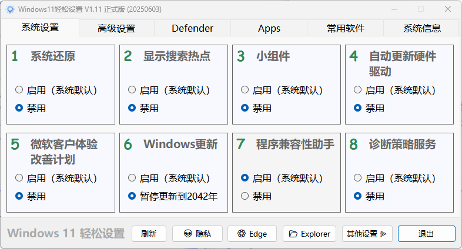
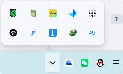
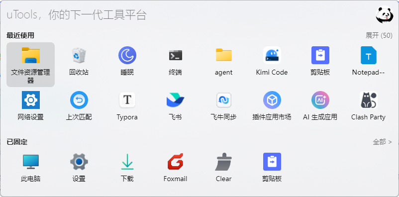
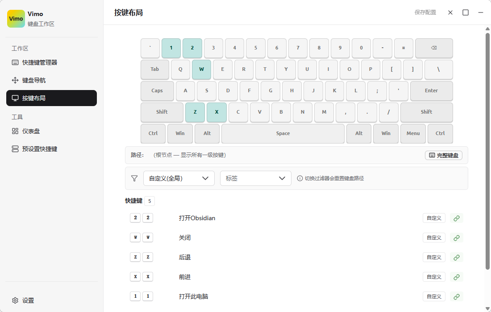
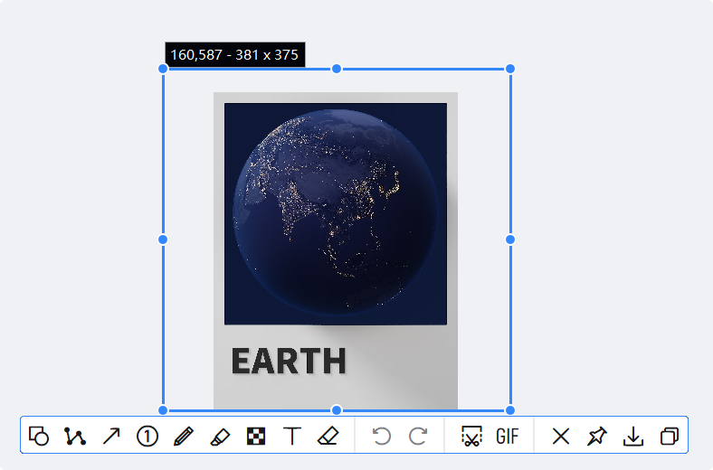
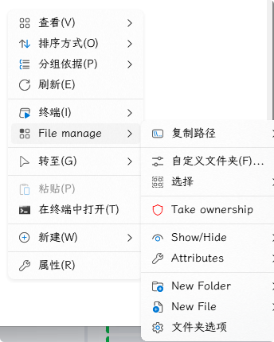
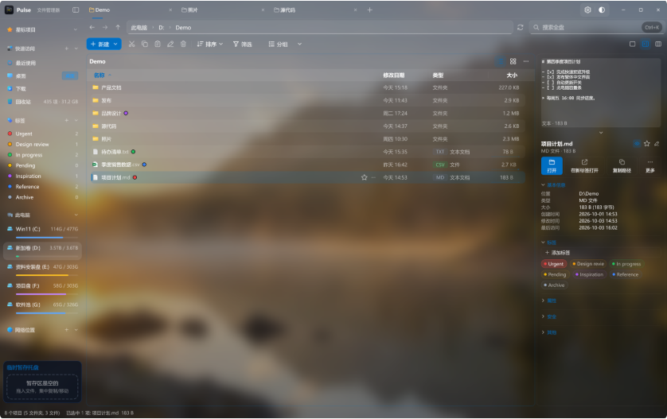

本文写于 2026 年 10 月 27 日，Windows 26H2 刚刚发布。

重装系统的念头，其实并不是为了体验什么新功能。uTools 更新到 8.0 之后换了 Electron 内核，会跟随系统的文字缩放，而我年纪大了，偏爱大一点的字体，早把系统缩放调到了 120%。结果每次打开 uTools 面板，迎面就是一堆雷霆大图标。发现这个问题后，我把缩放改回了默认的 100%，可大字看了好几年，一时半会儿实在适应不了，甚至怀疑是早先用 NoMeiryoUI 改坏了系统字体，才让字显得这么小。

但是实际结论是：大字体看久了，乍一回到 Windows 的默认尺寸，怎么都觉得别扭。但不管怎么说，系统还是重装了。

这次用的仍是 MSDN 下载的镜像「Windows 11 consumer editions 26H2」。安装过程不再赘述，这篇主要讲面对一个全新的系统，我会怎么配置。

## 回收站

在回收站上「右键-属性」，勾选「显示删除确认对话框」。这通常是我在新系统上做的第一件事——我实在担心哪天误触了 Delete 键删掉文件，却浑然不觉。

## 文件资源管理器

文件资源管理器就是 explorer.exe。我希望它默认打开「此电脑」，所以一般会先在「文件夹选项」里这样设置：

然后开始建数据盘。我的电脑有两块固态：C 盘 512G，D 盘 4T，这就是全部分区，我不会再额外拆分。C 盘用来装软件，D 盘用来放数据。

D 盘通常有这几个固定文件夹：

- AgentCode：AI Agent 的工作目录
- ProjectCode：古法编程的工作目录
- Document：存放各种文档
- Installation：部分软件的安装路径
- WorkSpace：公司项目的工作目录

图中的 Tencent Files 和 WPS Files 分别是微信、QQ 和 WPS 的数据文件夹，平时用不着打开，所以我把它们设成了隐藏。

这里值得单独说的是 Installation 文件夹。有运营商维护的软件，我一般装在默认位置，通常在 C 盘。除此之外，我电脑里还有不少 GitHub 上的开源软件，我偏爱便携版——很多软件其实根本用不到注册表。这类软件我会尽量放进 Installation，这样重装系统后连配置都不用重做：Foxmail 的邮箱、1Remote 的远程桌面、InputTip 的鼠标样式，这些习惯都养了很久，重新配一遍太麻烦。好在它们的数据就放在自己的安装目录下，整个文件夹拷到新电脑上就能直接用。

## 系统设置

新系统我通常用「Win11 轻松设置」把用不到的功能禁用或卸载，能显著减轻系统负担。

## 开机启动

开机启动只挑几个说。微信、QQ、IDM、UU 远程这几个大众软件都设了自启，不再啰嗦。

uTools：Alt+Space 唤出面板，很多快捷操作都能在里面完成。常用路径和软件都加进了本地启动，敲名字就能打开。

Vimo3：用 CapsLock 当超级键做快捷键映射，原本要两只手按的组合键，映射后单手就能按。

PixPin：截图、录屏、标注、贴图、OCR 集于一身，相当好用。

InputTip：把输入法状态和鼠标样式绑在一起，不用瞄右下角就知道当前是中英文。写代码需要频繁切换时特别好用——我的设置是中文用红鼠标、英文用蓝鼠标、大写用绿鼠标。

TailScale：用来和家里的 NAS 组虚拟局域网，访问 NAS 文件很方便。FnConnect 经常出问题，我一般只在网页端用它。

飞牛同步：在设备和 NAS 之间同步文件。说不上好用，但将就着能用，主要是懒得折腾。

NileSoft Shell：我很不喜欢 Windows 原生的右键菜单，于是换成了这个第三方菜单。最喜欢的功能是复制路径，非常顺手，还支持自定义样式和自定义命令。

Pulse。第三方的文件资源管理器，主要是为了弥补原生文件资源管理器相当难用的标签页功能，提供了空格预览的功能，并且极大的增加了文件搜索的速度。

